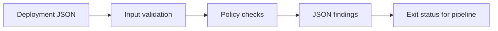

# Release Preflight

Catch common deployment configuration mistakes before contacting a Kubernetes cluster.

Release Preflight checks a Kubernetes Deployment expressed as JSON and emits machine-readable findings. It can run on a laptop or as a step in a delivery pipeline, without a cluster or cloud credentials.

## Try it

Requires Python 3.11 or newer; uses only the standard library.

```sh
python3 preflight.py deployment-pass.json
python3 preflight.py deployment-fail.json
python3 -m unittest -v
```

The passing fixture exits with code 0. The failing fixture exits with code 1 and reports three problems: one replica, a `latest` image tag, and a missing readiness probe. Invalid input exits with code 2. Example images are placeholders; these manifests are test fixtures and are not a runnable deployment of the search project.

For a YAML manifest, convert it to JSON with your existing deployment tooling before running the check.

## Checks

| Rule | What it checks |
| --- | --- |
| REPLICAS | At least two explicit replicas under this example availability policy |
| SELECTOR | Nonempty matchLabels matching the pod template |
| IMAGE_PIN | Explicit image tag or digest; rejects omitted tags and latest |
| RESOURCES | CPU and memory requests and limits are present |
| PROBE | Readiness and liveness probe handlers are present |
| NON_ROOT | runAsNonRoot is true |
| ESCALATION | allowPrivilegeEscalation is false |
| PRIVILEGED | privileged is not true |
| ROOT_FS | Root filesystem is read-only |
| HOST_ACCESS | Host network, PID, and IPC namespaces are not enabled |



## Pipeline integration

Run the tool after rendering a manifest and before deploying it:

```sh
python3 preflight.py rendered-deployment.json
```

A nonzero exit blocks a shell-based CI step. [VALIDATION.md](VALIDATION.md) records the local checks for this version. An automated GitHub Actions workflow runs the tests on pushes and pull requests.

## Scope and tradeoffs

This is a focused policy checker, not a Kubernetes schema validator, admission controller, vulnerability scanner, or security certification. It supports one Deployment object, not Lists, Helm charts, multi-document YAML, or other workloads. It handles matchLabels, not matchExpressions. It checks resource presence rather than parsing quantities or comparing requests with limits. It does not validate digest syntax or prove that image tags are immutable. Probe handlers are checked for presence, not operational correctness.

Policies are deliberately opinionated: a single replica may be appropriate for a development environment, and a read-only filesystem can require writable volumes. Adapt the policy to the workload rather than silencing findings without understanding them.

## Tests

The tests cover passing and failing fixtures, registry ports versus image tags, label mismatches, privileged containers, empty container lists, unsupported kinds, and input immutability.

## Next steps

Add Kubernetes schema validation, resource quantity comparisons, init-container checks, and configurable development versus production policies. Keep policy failures structured so a CI system can present them clearly.

MIT licensed.
